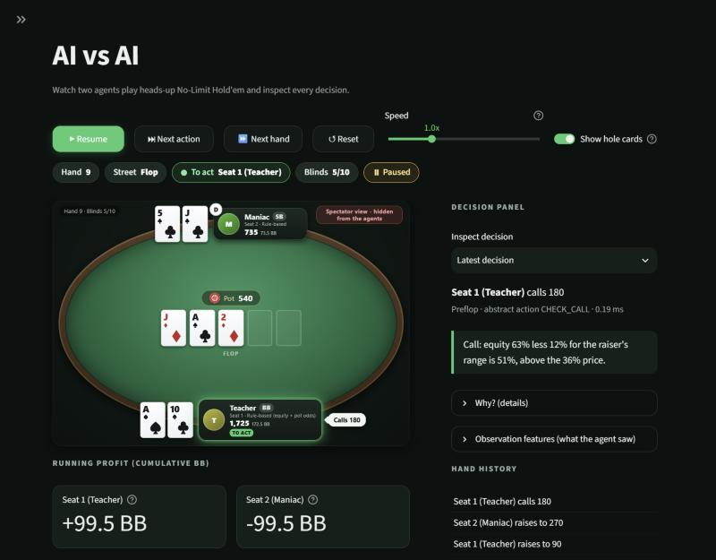
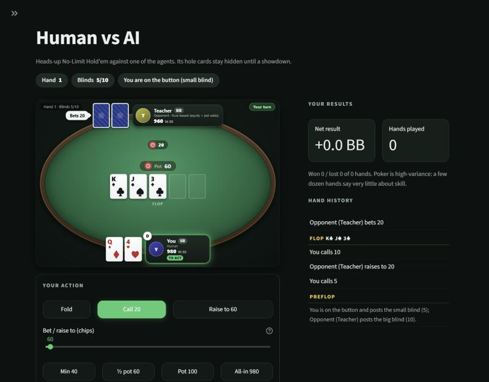
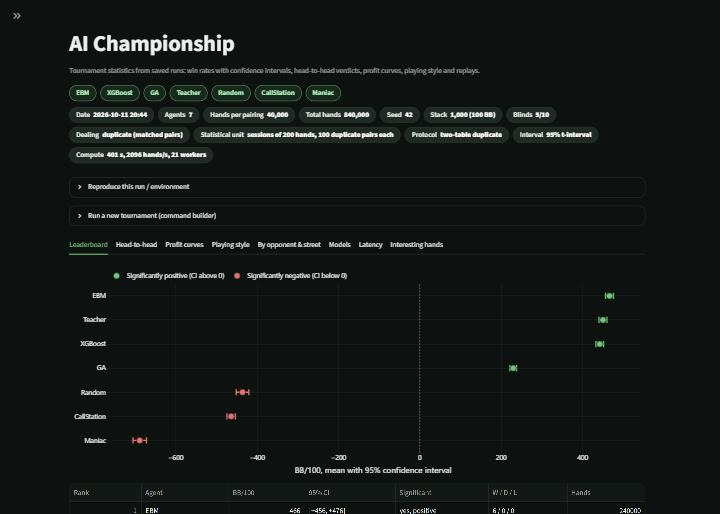
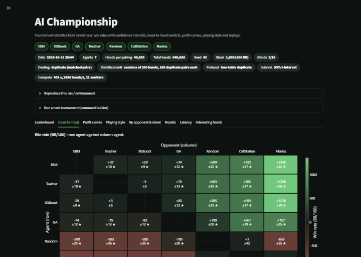

# AI Poker Arena

**Explainable AI agents learn heads-up No-Limit Texas Hold'em, compete in reproducible tournaments, and can be challenged by humans.**

Three independently trained architectures — an **Explainable Boosting Machine (EBM)**, **XGBoost**, and a **Genetic Algorithm (GA)** evolved purely through gameplay — play on a PokerKit-backed rules engine with a strict information boundary (no agent can see hidden cards), are compared with duplicate-deal tournaments and honest confidence intervals, and are explored through a Streamlit app and four research notebooks.

This is an educational / experimental project about **Explainable AI**, learning, evolutionary search and decision making under uncertainty. No real money, no external services, no GPU: everything runs on a laptop CPU.

<p align="center">
  
  
</p>
<p align="center">
  
  
</p>

## Contents

- [Results at a glance](#results-at-a-glance)
- [Quick start](#quick-start) (Windows, macOS, Linux)
- [The Streamlit app](#the-streamlit-app)
- [The three agents](#the-three-agents) (+ the teacher, baselines)
- [Reproduce everything](#reproduce-everything): data, training, tournaments, notebooks
- [Research notebooks](#research-notebooks)
- [Architecture and the information boundary](#architecture-and-the-information-boundary)
- [Research methodology and limitations](#research-methodology-and-limitations)
- [Extending the arena](#extending-the-arena): RL agents, local LLMs, specialised models, more players
- [Project layout](#project-layout) · [Tests](#tests) · [License](#license)

---

## Results at a glance

Official tournament `artifacts/tournaments/20261011-204425_official`: all 7 agents, full round-robin (21 pairings), **40,000 hands per pairing**, 1,000-chip stacks (100 big blinds) reset every hand, blinds 5/10, seed 42 in the held-out `eval` seed namespace (never used in training), **two-table duplicate deals** (every deal is played twice at two independent tables with the two players swapped between button and big blind). BB/100 = big blinds won per 100 hands; intervals are 95% t-intervals over 200 independent 200-hand sessions per pairing.

| Rank | Agent | BB/100 (pooled over 6 opponents) | 95% CI | Wins / Losses / Ties vs. the others |
|---:|---|---:|---|---|
| 1 | **EBM** | +466 | [+456, +476] | 6 / 0 / 0 |
| 2 | Teacher (rule-based reference) | +450 | [+440, +460] | 4 / 1 / 1 |
| 3 | **XGBoost** | +442 | [+433, +452] | 4 / 1 / 1 |
| 4 | **Genetic Algorithm** | +230 | [+221, +238] | 3 / 3 / 0 |
| 5 | Random | -436 | [-451, -420] | 0 / 5 / 1 |
| 6 | CallStation | -464 | [-474, -453] | 0 / 4 / 2 |
| 7 | Maniac | -688 | [-705, -672] | 1 / 4 / 1 |

Head-to-head (BB/100 of the **row** agent against the **column** agent):

| Row vs. column | EBM | Teacher | XGBoost | GA | Random | CallStation | Maniac |
|---|---:|---:|---:|---:|---:|---:|---:|
| **EBM** | – | +37 | +29 | +74 | +599 | +722 | +1,335 |
| **Teacher** | -37 | – | -3 | +75 | +603 | +705 | +1,358 |
| **XGBoost** | -29 | +3 | – | +83 | +585 | +693 | +1,318 |
| **GA** | -74 | -75 | -83 | – | +190 | +661 | +757 |
| **Random** | -599 | -603 | -585 | -190 | – | +1 | -638 |
| **CallStation** | -722 | -705 | -693 | -661 | -1 | – | +0 |
| **Maniac** | -1,335 | -1,358 | -1,318 | -757 | +638 | -0 | – |

How to read this honestly (details and caveats in the notebooks and [docs/METHODOLOGY.md](docs/METHODOLOGY.md)):

- **EBM and XGBoost were trained to *imitate* the transparent rule-based teacher** (97.9% / 99.8% agreement with the teacher on held-out states). Imitation accuracy is not poker skill — the tournament is what measures play. The EBM *beating its own teacher* (+37, CI [+27, +47]) is a surprising empirical result that Notebook 4 investigates with controlled experiments (replications on two new seeds pool to a smaller +28 BB/100, so the official estimate is probably at the high end; the edge vanishes when both agents ignore opponent statistics, i.e. it is an adaptation effect); it should **not** be read as "the EBM understands poker better than the rule it copied".
- **XGBoost vs. the teacher is a statistical tie** (XGBoost minus Teacher +3.5, CI [-1.7, +8.6]), as expected for a 99.8% accurate copy; the EBM also beats XGBoost (+29, CI [+20, +38]).
- **The GA learned from gameplay alone** (no labels, no teacher). It beats the three simple baselines but loses to the three stronger agents (by 74–83 BB/100) — evolution with a modest budget did not match a hand-designed policy.
- Among the three simple bots, CallStation is tied with both Random and Maniac, while Maniac beats Random by +638 yet finishes *last* overall: the pooled score is dominated by how badly each bot is exploited by the strong agents. Weak bots are poor yardsticks for comparing strong agents.
- Poker is high variance: every number above carries an interval; "significant" only means the interval excludes zero.
- **Protocol note.** An earlier version of our duplicate protocol let the two plays of a deal share agents and opponent statistics, which gave the *second* player of each deal a small edge between adaptive agents (about +10 to +13 BB/100 between identical Teachers). Notebook 4's A/A test exposed it, an independent 800-session replication confirmed it, and it was replaced by the two-table protocol used for all numbers here (identical agents now cancel exactly; the old protocol is kept only as a diagnostic). The conclusions above survived the correction; the numbers moved by tens of BB/100 at most.

Small trained models (EBM 3.7 MB, XGBoost 7 MB, GA 260 KB) and this tournament run are committed, so the app works right after cloning.

---

## Quick start

Requires **Python 3.11+** (developed and tested with 3.13 on Windows 11).

### Windows (PowerShell)

```powershell
git clone <your-fork-url> AI-Poker-Arena
cd AI-Poker-Arena
py -3.13 -m venv .venv            # any Python >= 3.11 works: py -3.11 / py -3.12 ...
.venv\Scripts\Activate.ps1        # cmd.exe: .venv\Scripts\activate.bat
python -m pip install --upgrade pip
pip install -e ".[dev]"
streamlit run app/Home.py
```

If PowerShell blocks the activation script: `Set-ExecutionPolicy -Scope Process Bypass`.

### macOS / Linux

```bash
git clone <your-fork-url> AI-Poker-Arena && cd AI-Poker-Arena
python3 -m venv .venv && source .venv/bin/activate
pip install --upgrade pip && pip install -e ".[dev]"
streamlit run app/Home.py
```

`requirements.txt` lists the same dependencies; `requirements-lock.txt` records the exact versions the project was developed with. In the examples below, `python` means the interpreter of the activated virtual environment (or `.venv/Scripts/python` on Windows if you did not activate it).

Check the installation: `pytest -m "not slow"` (1,241 tests, about 3–4 minutes on a 22-core laptop).

---

## The Streamlit app

`streamlit run app/Home.py` (run it from the repository root so the theme in `.streamlit/config.toml` is picked up).

| Mode | What it does |
|---|---|
| **AI vs AI** | Pick any two available agents, watch them play on a poker table. Start/reset, pause/resume, *next action*, *next hand*, speed slider (slow by default so you can follow). A decision panel shows each agent's explanation (EBM term contributions, SHAP values, GA rule traces, teacher rules) and the features it saw; hidden cards of the "spectator view" can be toggled. |
| **AI Championship** | A statistics dashboard over *precomputed* tournament runs (the page only reads saved results, heavy simulation never runs inside the web app): leaderboard with confidence intervals, head-to-head matrix with significance, cumulative profit curves with luck bands, playing-style radar, performance by opponent and street, latency, training/model summaries, and replays of interesting hands. A command builder generates the exact `scripts/run_tournament.py` call for a new run. |
| **Human vs AI** | Play against the EBM, XGBoost, GA or the teacher. Legal betting controls (fold, check/call, raise slider, ½-pot / pot / all-in shortcuts), clear turn indicator, hand outcome, "play next hand". **The AI's hole cards are never sent to the browser during a hand** (unit-tested) and only appear after a showdown. Optional post-hand explanations show why the AI acted as it did. |

State lives in Streamlit's per-session `st.session_state`; cached models are shared read-only while every browser session gets its own agent copies.

Screenshots: [`docs/screenshots/`](docs/screenshots/).

---

## The three agents

All agents see the same thing — a restricted `Observation` — and choose from the same discretised, legality-masked action space: *fold, check/call, half-pot raise, pot-sized raise, all-in* (mapped to genuinely legal No-Limit raise amounts, including minimum raises and short stacks).

### 1. Explainable Boosting Machine (`ebm`)
InterpretML's `ExplainableBoostingClassifier`: an additive model of one shape function per feature plus 40 learned pairwise interaction surfaces. Every decision decomposes *exactly* into per-term log-odds contributions, and the global shape functions can be read directly. Trained by imitation (with DAgger rounds) on teacher-labelled decisions. → [Notebook 1](notebooks/01_ebm_poker_agent.ipynb)

### 2. XGBoost (`xgboost`)
A gradient-boosted tree ensemble (multiclass soft-max) trained on the **same dataset and 45-feature schema** as the EBM. Explanations come from exact TreeSHAP values. → [Notebook 2](notebooks/02_xgboost_poker_agent.ipynb)

### 3. Genetic Algorithm (`ga`)
A population of 18-gene strategies (preflop open/defend/3-bet thresholds, value-bet and call thresholds, bluff and semi-bluff frequencies, bet-size mix, position bonus, stack-depth caution, opponent-adaptation weights, ...) evolved by **tournament selection, blend crossover and Gaussian mutation**. Fitness is profit from simulated games against a diverse opponent pool and a hall of fame, with duplicate deals (the legacy single-table variant at training time, see the protocol note above), common random numbers inside a generation and fresh deals every generation; a held-out validation set that includes unseen opponents guards against overfitting. The evolved strategy is a readable rule cascade whose parameters can be inspected. → [Notebook 3](notebooks/03_genetic_algorithm_poker_agent.ipynb)

### Reference policies
* **Teacher** (`teacher`): a transparent, deterministic equity / pot-odds / position policy (all thresholds in one documented dataclass). It is the *source of the training labels* for the EBM and XGBoost, and also a tournament participant.
* **Baselines**: `random`, `call_station`, `maniac`.

**Features (45, shared by training and inference):** hand strength (equity vs. a random hand, preflop percentile, made-hand category, draws), board texture, position, stack/pot sizes in big blinds, pot odds and SPR, betting history, and *opponent statistics derived only from previously observed public actions* (VPIP, PFR, aggression, fold-to-bet, showdown rate).

**Beyond pure imitation:** a model that copies a teacher inherits its behaviour *and* its blind spots, and plain behaviour cloning suffers covariate shift (the learner visits states the teacher never produced). We therefore implemented **DAgger** (the learner plays, the teacher relabels the states it visited, aggregate, refit) and *measured* it: it slightly improves agreement on the learner's own states, but made no measurable difference in the validation duplicate-deal BB/100 used to select the final round. Alternatives considered and why they were not chosen (outcome-value regression: too noisy for laptop budgets; solvers/CFR: out of scope for full NLHE; RL: future work) are documented in [docs/METHODOLOGY.md](docs/METHODOLOGY.md).

---

## Reproduce everything

Every training script starts with imports followed *immediately* by a clearly marked configuration block. Edit the variables directly, use a fast preset with `--smoke`, or override from the command line with `--set KEY=VALUE`. The effective configuration, seeds, library versions and metrics are saved next to each model.

```python
# ==========================================
# TRAINING CONFIGURATION
# ==========================================
RANDOM_SEED = 42
STARTING_STACK = 1000
SMALL_BLIND = 5
BIG_BLIND = 10
...
SMOKE_OVERRIDES = {...}      # applied by --smoke
```

| Step | Command | Time on a 22-core laptop |
|---|---|---|
| 1. Generate the teacher-labelled dataset | `python scripts/generate_dataset.py` (`--smoke`) | ~1 min (estimated 5–6 min on 4 cores) |
| 2a. Train the EBM | `python scripts/train_ebm.py` (`--smoke` ≈ 40 s) | ~14 min on 10 cores |
| 2b. Train XGBoost | `python scripts/train_xgboost.py` (`--smoke` ≈ 30 s, `--tune` for the one-factor tuning table) | ~8 min on 10 cores |
| 2c. Evolve the GA | `python scripts/train_ga.py` (`--smoke` ≈ 15 s, `--evaluate-only` refreshes the held-out evaluation) | ~24 min on 21 workers |
| 3. Run the tournament | `python scripts/run_tournament.py --set RUN_NAME=official --set NUM_TOURNAMENT_HANDS=40000` (`--smoke`, `--agents ebm,xgboost`) | ~7 min on 21 workers (shared machine) |
| 4. Build + execute the notebooks | `python scripts/build_notebooks.py --execute` | 3–4 min each for notebooks 1–3, ~12 min for notebook 4 |
| 5. Evaluate the teacher against baselines | `python scripts/evaluate_teacher.py` | a few minutes |

Examples:

```bash
python scripts/train_xgboost.py --smoke                       # quick end-to-end check
python scripts/train_ebm.py --set EBM_INTERACTIONS=20 --set DAGGER_ROUNDS=0
python scripts/run_tournament.py --agents ebm,xgboost,teacher --set NUM_TOURNAMENT_HANDS=20000
```

**Reproducibility:** all randomness is seeded; seeds are derived by `poker_arena.config.derive_seed(namespace, ...)` with separate namespaces for training data, validation, GA fitness, GA validation and tournament evaluation, so evaluation deals can never coincide with training deals. Results are identical regardless of the number of worker processes (tested). On the development machine, re-running the EBM and GA training reproduced the saved artifacts exactly (same seeds, same library versions). Dataset files are git-ignored (regenerate them with step 1); trained models and the official tournament run are committed.

---

## Research notebooks

Four notebooks in [`notebooks/`](notebooks/) use the same package code as the app and only load *saved* artifacts or run small, clearly labelled, seeded simulations. They separate **empirical findings** from **assumptions**, **speculation** and **limitations**. Sources are readable `py:percent` files in `notebooks/src/`; `scripts/build_notebooks.py` converts and executes them.

| Notebook | Content |
|---|---|
| [01 – EBM poker agent](notebooks/01_ebm_poker_agent.ipynb) | Data generation, features and targets, training and DAgger, classification vs. policy evaluation, global effects and interactions (InterpretML visualisations), local explanations compared with the teacher's ground-truth rules, what the EBM learned, limitations. |
| [02 – XGBoost poker agent](notebooks/02_xgboost_poker_agent.ipynb) | Same data, tuning, results, feature importance and SHAP analysis, example decisions, comparison with the EBM, interpretation and limitations. |
| [03 – Genetic algorithm poker agent](notebooks/03_genetic_algorithm_poker_agent.ipynb) | Genome, fitness design, selection/crossover/mutation demos, evolution curves, best strategy, population evolution, held-out evaluation, what evolution favoured and what it did not. |
| [04 – AI Championship](notebooks/04_ai_championship.ipynb) | Experimental design, tournament configuration, head-to-head results, baselines, matchup matrix and leaderboard, statistical uncertainty and replication, playing styles, interesting hands, an investigation of *EBM beats its teacher*, explainability comparison, conclusions and future research. |

---

## Architecture and the information boundary

```
                    ┌────────────────────────────── agents never import this side ───────────────┐
 Deal (seeded) ───► │ HandEngine (PokerKit)  hidden: both hands, burn cards, undealt board        │
                    └──────────────┬───────────────────────────────────────────┬─────────────────┘
                                   │ observation_for(seat)                     │ spectator_view() / HandRecord
                                   ▼                                           ▼   (UI, replays, analysis only)
                    Observation  (own hole cards, revealed board, pot, stacks, bets,
                                  legal actions, public history, opponent stats from past hands)
                                   │
                          ┌────────┴─────────┐
                          ▼                  ▼
                   features (45)        Agent.act(obs) ─► Decision(action, explanation)
                   build_features        EBM · XGBoost · GA · Teacher · baselines · (future agents)
```

* **Rules authority:** [PokerKit](https://github.com/uoftcprg/pokerkit) enforces betting order, minimum raises, side pots, showdown and chip settlement; our wrapper adds deterministic dealing from a seeded `Deal`, the observation boundary, and one convention (folding when a free check exists is not allowed). Chip conservation, legality and settlement are fuzz-tested over thousands of hands including tiny stacks.
* **Strict boundary:** an agent only ever receives a frozen `Observation` of plain values — no engine reference, no deck, no opponent cards, no seeds. The **same** interface is used during dataset generation, GA fitness evaluation, tournaments and live play. Tests include a *differential* test (identical public history, different hidden cards ⇒ identical observations, features and decisions), a card-universe audit, a pickle audit, an AST test forbidding agent/feature/training code from importing the engine, and negative controls proving the differential tests can fail (during development we additionally injected deliberate leaks by hand and confirmed that every one was caught). The boundary protects against accidental leakage and honest agents; code running *inside* `act()` could in principle inspect the Python call stack, so untrusted agents should run in a subprocess.
* **Agent interface:** `Agent.act(obs) -> Decision`, plus `reset(seed)`, `end_hand(summary)`, `explain(obs, decision)`; agents are created through a registry from small picklable specs. Trained agents validate their artifacts on load and raise `ModelArtifactError` — the system **never silently substitutes random play** for a model that failed to load.
* **Two-table duplicate deals:** every deal is played twice at two independent tables (own agent copies, own opponent statistics) with the two players swapped between button and big blind, so two identical agents sum to exactly zero and card luck cancels. (An earlier single-table version leaked information between the two plays of a deal; see *Protocol note* above and [docs/METHODOLOGY.md](docs/METHODOLOGY.md).)
* **Performance note:** PokerKit's showdown evaluation dominates runtime (~100–550 hands/s per core); equity estimation uses a validated, vectorised NumPy evaluator (0.2 ms for a 200-sample flop equity) and the tournament framework spreads sessions across processes.

Details: [docs/ARCHITECTURE.md](docs/ARCHITECTURE.md).

---

## Research methodology and limitations

Principles (full discussion in [docs/METHODOLOGY.md](docs/METHODOLOGY.md)):

1. **Prediction accuracy is not poker skill.** Imitation metrics and tournament results are measured and reported separately.
2. **Poker outcomes are noisy.** Two-table duplicate deals, many hands, held-out seeds, confidence intervals — and *sessions* (not hands or pairs) as the independent unit, because agents adapt to opponent statistics within a session.
3. **Explainability differs by architecture:** EBM = exact additive term contributions; XGBoost = SHAP attributions of a non-additive model; GA = readable rule cascade with evolved parameters. None of them is a causal account of "why a decision is good".
4. **Estimated equity is not profitability.** Our core feature is equity against a *random* hand; it ignores opponent ranges, fold equity and future betting.
5. **A legal action is not necessarily a good action;** the engine only guarantees legality.
6. **Fairness:** identical information, rules and action space for every agent.
7. **Reproducibility:** seeds, configs, library versions and fingerprints are saved with every artifact.

Known limitations: heads-up only (the engine API is seat-based so 3–6 players are possible future work); fixed 100 big blind stacks reset every hand; a 5-action abstraction; the EBM and XGBoost copy a heuristic teacher, so their ceiling and blind spots are the teacher's; one training seed per model; no exploitability / best-response evaluation, so results are *relative to this pool*, not a measure of distance from optimal play; the GA used a modest compute budget; tournament intervals describe sampling noise only, not model or design uncertainty.

---

## Extending the arena

The poker engine, tournament system and Streamlit app depend only on the `Agent` interface and the registry, so new architectures plug in without touching them. Planned directions that fit this design (none is implemented here):

* **Neural-network agents trained by reinforcement learning** (self-play, PPO/NFSP-style) — consume `build_features(obs)` or the raw `Observation`, return an abstract action from `obs.abstract_mask`.
* **Local LLM agents** (e.g. via Ollama) — serialise the `Observation` into a prompt, parse a legal action; the strict observation object makes leakage-by-prompt impossible by construction. Run them in a subprocess if untrusted.
* **Specialised "System One" decision models** (such as Kev) and further rule-based or statistical agents.
* **3–6 player tables** — the engine is seat-based; the observation, opponent tracking and tournament accounting would need to be generalised.

Minimal example:

```python
from poker_arena.agents.base import Agent, Decision
from poker_arena.agents.registry import register_agent, create_agent
from poker_arena.engine.actions import AbstractAction

class AlwaysCallAgent(Agent):
    name, architecture = "AlwaysCall", "Example"
    def act(self, obs):
        return Decision.from_abstract(obs, AbstractAction.CHECK_CALL)

register_agent("always_call", AlwaysCallAgent)
agent = create_agent("always_call")
```

Registered kinds appear in the tournament scripts and the app roster (add trained agents to `_LAZY` in `agents/registry.py`). Agents must follow the copy semantics in `docs/ARCHITECTURE.md` (§5) so they are safe to share between sessions and worker processes.

---

## Project layout

```
src/poker_arena/
  cards.py config.py               card encoding, game config, seed namespaces
  engine/                          PokerKit-backed engine, Observation, actions, sessions, records
  equity/                          vectorised hand evaluator, Monte-Carlo equity, preflop table
  agents/                          Agent interface, registry, baselines, teacher, EBM / XGBoost / GA agents
  features/                        45-feature schema shared by training and inference
  data/                            dataset generation, DAgger collection, duplicate-deal evaluation
  training/ evolution/             EBM / XGBoost training, GA operators + fitness evaluation
  tournament/                      headless runner, statistics, saved-results loader
  explain/                         explanation + plotting helpers (EBM, XGBoost, notebooks)
  ui/                              reusable Streamlit components (table renderer, charts, pages' logic)
app/                               Streamlit entry (Home.py) and pages
scripts/                           generate_dataset, train_ebm, train_xgboost, train_ga, run_tournament, build_notebooks, ...
notebooks/                         4 executed research notebooks (+ py:percent sources in notebooks/src)
artifacts/models/{ebm,xgb,ga}      trained models + metadata + training notes
artifacts/tournaments/             saved tournament runs (+ latest.json)
artifacts/figures/                 figures generated by training and notebooks
docs/                              ARCHITECTURE.md, METHODOLOGY.md, screenshots/
tests/                             pytest suites (rules, information boundary, features, models, tournament, UI, notebooks)
```

## Tests

```bash
pytest -m "not slow"     # 1,241 tests, ≈ 3–4 minutes
pytest                   # + 15 slow tests (large fuzz runs, statistical A/A calibration, teacher strength)
```

Highlights: PokerKit integration and chip conservation fuzzing, legal-action generation and abstraction mapping, the anti-cheating suite (differential, card-universe, pickle and AST tests), deterministic seeded simulation, feature parity between dataset generation and inference, model-action legality and loud failure on bad artifacts, tournament accounting and statistics (including coverage simulations), Streamlit `AppTest` runs with session isolation, and notebook build checks.

## License

MIT — see [LICENSE](LICENSE). PokerKit, InterpretML, XGBoost, SHAP, Streamlit and Plotly retain their own licenses.
